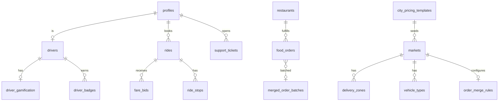

# Ride & Food — Architecture (100% TypeScript)

**Stack:** Expo (Web/Android/iOS) · Supabase (Postgres/PostGIS, Auth, Realtime, Storage, Edge Functions, Cron) · Vercel

**Explicitly removed:** AI Insights, heatmaps, weekly AI summaries, AI Setup Wizard, AI provider settings.  
City setup = pricing templates + manual config. Ops metrics = SQL views/KPIs.

## Monorepo tree

```
/
├── apps/
│   ├── rider/          # Expo Router — rides + food (Web/Android/iOS)
│   ├── driver/         # Expo Router — bidding, OTP trip, merged deliveries, XP
│   ├── partner/        # Expo Router — restaurant orders & menu
│   ├── admin/          # Expo Web / Vercel — ops, config, settings, support desk
│   └── landing/        # Vercel — marketing + public live tracking
├── packages/
│   ├── types/          # Domain + RPC/Realtime contracts
│   ├── config/         # Env (Zod), theme, variants, payment public keys
│   ├── supabase/       # Typed client, auth, realtime, RPC helpers
│   ├── utils/          # Currency, pricing, merge rules, platform links
│   └── ui/             # Cross-platform UI (Map, OTP, Bid, Merge, XP cards)
├── supabase/
│   ├── config.toml
│   ├── migrations/     # SQL: schema, PostGIS, RLS, RPCs, triggers, cron
│   ├── functions/      # Deno Edge Functions (TS) — payments, refunds, billing
│   └── seed/           # Optional demo + city pricing templates
├── docs/
│   └── ARCHITECTURE.md
├── package.json        # npm workspaces
└── tsconfig.base.json
```

## Capability → persistence map (no AI)

| Capability | Implementation |
|---|---|
| Dual pricing | `markets.pricing_mode` ∈ {fixed, bidding} |
| Promos | `promo_codes` + usage tables + RPC validate |
| Multi-currency | `markets.currency_code` / `delivery_zones.currency_code` |
| City setup | `city_pricing_templates` + admin apply RPC |
| Ops KPIs | SQL views `v_market_kpis` |
| Gamification | triggers on trip/delivery complete → XP/levels/badges |
| OTP trip start | `rides.otp_code` + `start_ride` RPC |
| Support desk | `support_tickets` + Realtime channel |
| Order merge | `merged_order_batches` + eligibility RPC |
| Subscriptions | `subscription_plans` / `user_subscriptions` |

## Schema ERD (core)



## Deploy notes (high level)

- **Mobile:** EAS Build for rider/driver/partner (`EXPO_PUBLIC_SUPABASE_*`)
- **Web:** Vercel projects for `apps/admin`, `apps/landing`, and Expo web exports for rider/driver/partner as needed
- **Backend:** Supabase project — run migrations, enable PostGIS, schedule `pg_cron` jobs
